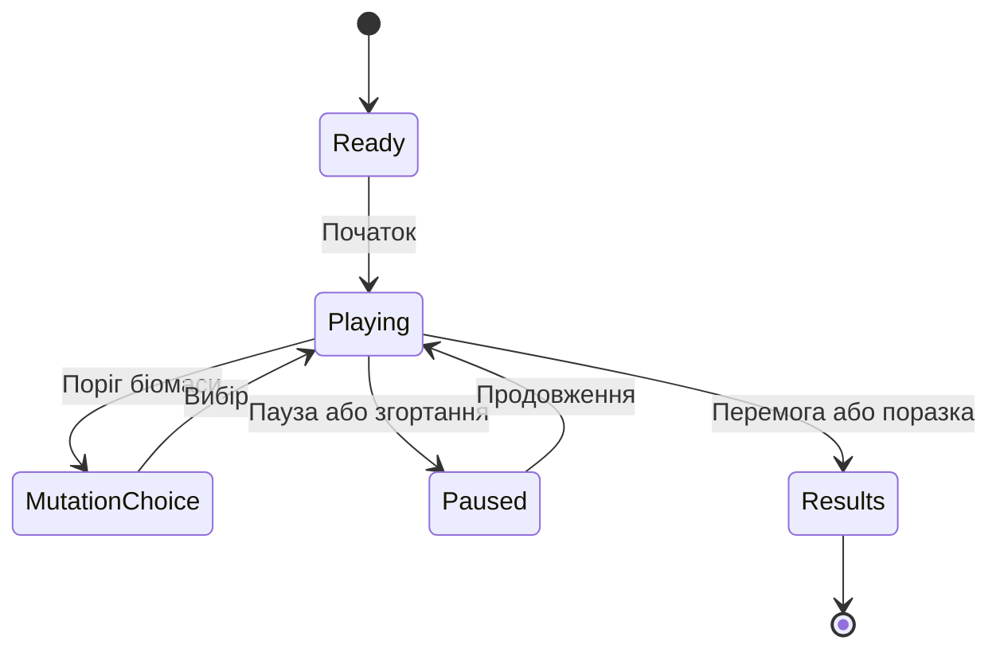

# 03. Основний цикл, камера та керування

Статус: пропозиція v0.1. Пов'язані рішення: D-02–D-08, D-10.

## 1. Три масштаби гри

**Кілька секунд:** помітити небезпеку, обрати позицію, зачепити потрібного ворога, уникнути атаки, завершити захоплення.

**Один сектор:** виконати ціль, кілька разів еволюціонувати й пройти завершальне зіткнення. Основна тривалість звичайного сектора — 3–5 хвилин як ціль дизайну.

**Кілька сесій:** відкривати наступні сектори й нові варіанти мутацій, пробувати інші збірки та покращувати власне проходження. Обсяг постійного розвитку ще відкритий у D-11.

## 2. Послідовність забігу

1. Гравець вибирає доступний сектор і бачить його головну ціль.
2. Істота з'являється в безпечній стартовій зоні; керування доступне відразу.
3. Гравець входить у зіткнення й отримує біомасу за завершені поглинання.
4. Досягнення порога відкриває вибір мутації; симуляція бою зупиняється.
5. Після вибору змінюються характеристики, здібності й відповідна деталь моделі.
6. Нові зіткнення перевіряють використання мутації, гака та руху.
7. Виконання цілі відкриває вихід. Вихід і живий персонаж завершують сектор перемогою.
8. Екран результату показує підсумок, постійну нагороду й наступну дію.

Забіг завершується поразкою при нульовому здоров'ї. До результату можна перейти лише один раз, навіть якщо в один кадр надходять кілька подій шкоди та виконання цілі. Правило пріоритету: якщо персонаж уже загинув до активації виходу, перемога не нараховується.

## 3. Стани забігу

Під час `MutationChoice` і `Paused` не рухаються вороги, не проходять бойові таймери та не витрачаються перезарядки. У `Results` заборонені бойові події та повторна видача нагород. Перехід у фон з екрана мутації залишає вибір відкритим після повернення.

## 4. Камера

Пропонується ортографічна камера зверху під кутом. Персонажі й середовище тривимірні; бойовий рух відбувається переважно по площині підлоги. Висота використовується для вигляду й ефектів, а не для складної платформної навігації.

Камера м'яко слідує за істотою та залишає більше видимого простору в напрямі руху. Стрибки масштабу під час звичайної атаки не потрібні. На босі можна трохи розширити огляд за заздалегідь підготовленою камерною зоною.

Стіни, що закривають гравця, опускаємо або ховаємо контрольовано. Важливі вороги не повинні атакувати з області, яку постійно перекриває HUD. Телеграф атаки з краю огляду має бути видимим до моменту ураження.

## 5. Базовий варіант керування для прототипу

| Дія | Пропоноване керування | Зворотний зв'язок |
| --- | --- | --- |
| Рух | Плаваючий джойстик у нижній лівій зоні | Поза й напрям тіла, легка реакція опорних кінцівок |
| Базова атака | Автоматично по доступній цілі в радіусі | Контур вибраної цілі, рух атакувального щупальця |
| Гак | Кнопка справа; натиск активує захоплену системою ціль | Попереднє позначення цілі й заповнення перезарядки |
| Вибір мутації | Натиск картки на зупиненому екрані | Назва, короткий ефект і зміна силуету |
| Пауза | Кнопка зверху й системне згортання | Видимий стан паузи |

Це схема з двома зонами взаємодії. Вона не обіцяє комфортного безперервного бою одним пальцем. D-03 порівнює її з повністю автоматичним гаком і з ручним прицілюванням; для першого прототипу вибираємо одну схему, щоб не будувати одразу три інтерфейси.

На комп'ютері під час розробки рух можна перевіряти клавіатурою, а гак — кнопкою. Оцінка зручності все одно потребує сенсорного екрана.

## 6. Рух і напрям атаки

Напрям джойстика задає бажану швидкість у координатах видимої підлоги. Відпускання пальця зупиняє рух із коротким керованим уповільненням. Персонаж не продовжує їхати через накопичену фізичну інерцію.

Зіткнення з декором не повинні зачіпати декоративні щупальця. Рухове тіло має просту форму, а відростки візуально огинають поверхні або ховаються. Після мутації в MVP зберігаємо стабільну форму основної колізії, щоб істота проходила знайомими коридорами.

Базова атака дозволена під час руху. Напрям корпусу може трохи відставати від обраної цілі, але механіка не вимагає повертатися до неї всім тілом. Візуальна поза повинна показувати, які кінцівки відповідають за рух, а які — за контакт.

## 7. Вибір цілі

Для базової атаки система відкидає мертві, недоступні та закриті суцільною перешкодою цілі. Серед доступних надає перевагу вже вибраній цілі, потім близькій загрозі. Коротка стабілізація вибору запобігає постійному смиканню між двома сусідніми ворогами.

Для гака ціль позначається до натиску. Перевага — противнику в напрямі наміру гравця, далі враховується дистанція. Важливіші за формулу передбачуваність і видимий маркер. Окреме налаштування «завжди чіпляти найсильнішого» у MVP не потрібне.

Якщо валідної цілі немає, кнопка гака показує недоступність і не витрачає перезарядку. Якщо ціль була валідною при випуску, але вислизнула під час польоту, відбувається промах із витратою перезарядки. Це різні події з різною реакцією інтерфейсу.

## 8. Роль гака

Гак — інструмент контролю позиції. Він допомагає витягнути стрільця, зламати побудову групи або перервати дозволену атаку. Сам гак не дає автоматичної перемоги й не поглинає здорового противника миттєво.

Пропозиція для MVP: гак притягує доступного звичайного ворога до вільної позиції перед істотою. Для важкої захищеної цілі діють окремі правила опору. Боса за корпус не тягнемо; його слабкі вузли й допоміжні цілі описані в розділі 04.

Пересування самої істоти до стіни або ворога за допомогою гака — окрема майбутня механіка. Вона змінює навігацію й дизайн арен, тому не входить до базового MVP без рішення D-05.

## 9. Мутація під час небезпеки

Коли досягнуто кілька порогів біомаси одним завершенням подій, вибори ставляться в чергу. Відкриваємо по одному екрану. Після кожного вибору перераховуємо доступні картки й актуальні характеристики.

Поки гравець читає картки, небезпека не рухається. Після закриття екрана керування не повинно помилково приймати натиск картки за натиск гака або рух джойстика. Усі старі дотики скидаємо й чекаємо нового введення.

Якщо одночасно із досягненням порога вже зафіксовано смерть персонажа, спочатку завершуємо забіг поразкою. Екран мутації не відкривається поверх результату.

## 10. Перерва, вихід і повтор

Згортання зупиняє симуляцію. Після повернення гра показує паузу й чекає явного продовження. Якщо процес Android був завершений, пропонується повернення до останнього збереженого стану між секторами; відновлення середини бою в MVP поки не планується.

Постійні нагороди видаються за правилами розділу 05. Добровільний вихід із незавершеного сектора не створює нагороду за перемогу. Кнопка рестарту запускає новий `run_id`, новий тимчасовий розвиток і чисті бойові стани.

## 11. Що перевіряємо руками

Зручність джойстика й гака під час одночасного руху; передбачуваність вибраної цілі; читабельність щупалець у натовпі; чи цікаво обходити й розбирати групу; чи змінює мутація наступну дію. Записуємо відео та причини помилок. Додавання контенту не виправить незручний основний контакт — спочатку доводимо ці взаємодії.
