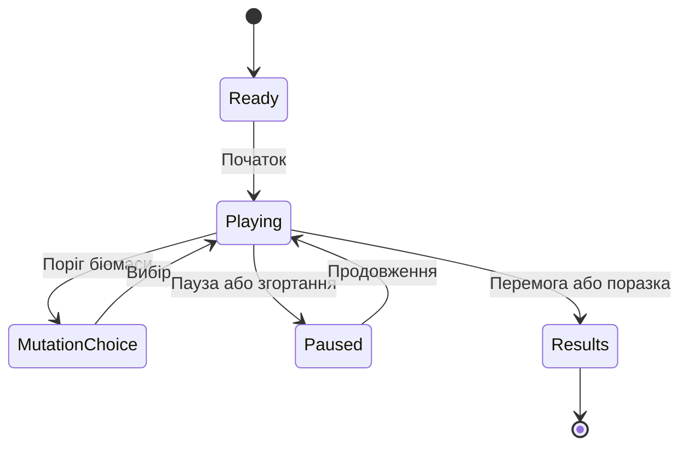

# 03. Основний цикл, камера та керування

Статус: редакція v0.4. Функції, валюта, середній темп і зони складності обрані; керування та межі забігу — пропозиції. Пов'язані рішення: D-02–D-12.

## 1. Три масштаби гри

**Кілька секунд:** помітити небезпеку, обрати позицію та застосувати доступну функцію відростка: притягнути ворога, перемістити героя або провести сильний удар. Спосіб доступу до функцій ще визначаємо в D-03.

**Один сектор:** виконати ціль, кілька разів еволюціонувати й пройти завершальне зіткнення. Основна тривалість звичайного сектора — 3–5 хвилин як ціль дизайну.

**Кілька сесій:** відкривати наступні сектори й нові варіанти мутацій, пробувати інші збірки та покращувати власне проходження. Обсяг постійного розвитку ще відкритий у D-11.

## 2. Послідовність забігу

Після рішення про зони опис нижче лишається сценарієм перевірки однієї зони як короткого окремого забігу. Вільний перехід, порядок доступу й перенесення мутацій ще відкриті в D-09. Перетин умовної межі не прирівнюється автоматично до нового забігу або перемоги.

1. Гравець вибирає доступний сектор і бачить його головну ціль. Для застосування доступні лише вже відкриті здібності; схема їх вибору ще визначається в D-03.
2. Істота з'являється в безпечній стартовій зоні; керування доступне відразу.
3. Гравець входить у зіткнення відповідного рівня зони й отримує біомасу за завершені поглинання.
4. Досягнення порога відкриває вибір мутації; симуляція бою зупиняється.
5. Після вибору змінюються характеристики, здібності й відповідна деталь моделі.
6. Нові зіткнення перевіряють використання мутації, гака та руху.
7. Виконання цілі відкриває вихід. Вихід і живий персонаж завершують сектор перемогою.
8. Екран результату показує підсумок, постійну нагороду й наступну дію.

Забіг завершується поразкою при нульовому здоров'ї. До результату можна перейти лише один раз, навіть якщо в один кадр надходять кілька подій шкоди та виконання цілі. Правило пріоритету: якщо персонаж уже загинув до активації виходу, перемога не нараховується.

## 3. Стани забігу

Під час `MutationChoice` і `Paused` не рухаються вороги, не проходять бойові таймери та не витрачаються перезарядки. У `Results` заборонені бойові події та повторна видача нагород. Перехід у фон з екрана мутації залишає вибір відкритим після повернення.

## 4. Камера

Пропонується ортографічна камера зверху під кутом. Персонажі й середовище тривимірні; бойовий рух відбувається переважно по площині підлоги. Висота використовується для вигляду й ефектів, а не для складної платформної навігації.

Камера м'яко слідує за істотою та залишає більше видимого простору в напрямі руху. Стрибки масштабу під час звичайної атаки не потрібні. На босі можна трохи розширити огляд за заздалегідь підготовленою камерною зоною.

Стіни, що закривають гравця, опускаємо або ховаємо контрольовано. Важливі вороги не повинні атакувати з області, яку постійно перекриває HUD. Телеграф атаки з краю огляду має бути видимим до моменту ураження.

## 5. Базовий варіант керування для прототипу

| Дія | Пропоноване керування | Зворотний зв'язок |
| --- | --- | --- |
| Рух | Плаваючий джойстик у нижній лівій зоні | Поза й напрям тіла, легка реакція опорних кінцівок |
| Базова атака | Автоматично по доступній цілі в радіусі | Контур вибраної цілі, рух атакувального щупальця |
| Активний варіант здібності | Попередньо — кнопка справа; вибір функції та прицілювання ще вирішуються в D-03 | Іконка поточної функції, валідна ціль/точка, її перезарядка |
| Вибір мутації | Натиск картки на зупиненому екрані | Назва, короткий ефект і зміна силуету |
| Пауза | Кнопка зверху й системне згортання | Видимий стан паузи |

Це попередня схема з двома зонами взаємодії. D-03 тепер має визначити не лише ручне/автоматичне прицілювання, а й один активний варіант на забіг, перемикання або кілька кнопок. Вибір Венома й трьох функцій не означає автоматичне затвердження трьох одночасних кнопок. Варіанти — [у розділі 13](13_SYMBIOTE_ABILITIES.md).

На комп'ютері під час розробки рух можна перевіряти клавіатурою, а гак — кнопкою. Оцінка зручності все одно потребує сенсорного екрана.

## 6. Рух і напрям атаки

Напрям джойстика задає бажану швидкість у координатах видимої підлоги. Відпускання пальця зупиняє рух із коротким керованим уповільненням. Персонаж не продовжує їхати через накопичену фізичну інерцію.

Зіткнення з декором не повинні зачіпати декоративні щупальця. Рухове тіло має просту форму, а відростки візуально огинають поверхні або ховаються. Після мутації в MVP зберігаємо стабільну форму основної колізії, щоб істота проходила знайомими коридорами.

Базова атака дозволена під час руху. Напрям корпусу може трохи відставати від обраної цілі, але механіка не вимагає повертатися до неї всім тілом. Візуальна поза повинна показувати, які кінцівки відповідають за рух, а які — за контакт.

## 7. Вибір цілі

Для базової атаки система відкидає мертві, недоступні та закриті суцільною перешкодою цілі. Серед доступних надає перевагу вже вибраній цілі, потім близькій загрозі. Коротка стабілізація вибору запобігає постійному смиканню між двома сусідніми ворогами.

Для AB-PULL ціль позначається до натиску. Перевага — противнику в напрямі наміру гравця, далі враховується дистанція. AB-MOVE натомість показує допустиму опору та кінцеву позицію героя; AB-DAMAGE — ціль або область сильного удару. Остаточне прицілювання залежить від D-03.

Якщо для поточної функції немає валідної цілі/точки, кнопка показує недоступність і не витрачає перезарядку. Валідований запуск із подальшим промахом витрачає її за правилом конкретного варіанта. Недоступність до старту й промах після старту мають різну реакцію інтерфейсу.

## 8. Три ролі симбіотичного відростка

За рішенням власника закладено варіативність: **притягування, переміщення й підвищена шкода**. Це різні результати застосування одного симбіотичного інструмента, а не вимога одночасно виконувати їх кожним натиском.

AB-PULL переміщує доступного противника до героя й допомагає розбирати групу. AB-MOVE переміщує самого героя до допустимої точки з перевіркою траєкторії. AB-DAMAGE пропонується як сильний удар/ультимейт із довшою перезарядкою. Гак сам собою не поглинає здорового ворога.

Пересування гаком тепер входить до обраних функцій і враховується в дизайні арен. Хитання, вільне лазіння по стінах і багатоповерховість ще не обрані. Для важких цілей, опор, перешкод і переривання див. [розділ 13](13_SYMBIOTE_ABILITIES.md).

Один активний варіант, перемикання чи одночасні здібності — відкрите D-03. Спільний або окремі cooldown також ще не вирішені. Перший тест може порівняти три окремі запуски кімнати з однією активною функцією в кожному.

Відкриття за ігрову валюту вже обрано в D-11. Пропонується проводити його в меню й зберігати між забігами, а активні бойові таймери лишати станом поточного забігу. Ціна відкриття не сплачується за кожен удар. Кількість одночасних кнопок визначається окремо; див. [економіку](05_EVOLUTION_AND_ECONOMY.md).

## 9. Мутація під час небезпеки

Коли досягнуто кілька порогів біомаси одним завершенням подій, вибори ставляться в чергу. Відкриваємо по одному екрану. Після кожного вибору перераховуємо доступні картки й актуальні характеристики.

Поки гравець читає картки, небезпека не рухається. Після закриття екрана керування не повинно помилково приймати натиск картки за натиск гака або рух джойстика. Усі старі дотики скидаємо й чекаємо нового введення.

Якщо одночасно із досягненням порога вже зафіксовано смерть персонажа, спочатку завершуємо забіг поразкою. Екран мутації не відкривається поверх результату.

## 10. Перерва, вихід і повтор

Згортання зупиняє симуляцію. Після повернення гра показує паузу й чекає явного продовження. Для короткого прототипу після завершення процесу Android пропонується відновити збережений профіль перед новою спробою. Контрольні точки й відновлення довшої локації визначаємо після вибору переходів у D-09; середина живого бою ще не серіалізована.

Постійні нагороди видаються за правилами розділу 05. Добровільний вихід із незавершеного сектора не створює нагороду за перемогу. Кнопка рестарту запускає новий `run_id`, новий тимчасовий розвиток і чисті бойові стани.

## 11. Що перевіряємо руками

Зручність джойстика й гака під час одночасного руху; передбачуваність вибраної цілі; читабельність щупалець у натовпі; чи цікаво обходити й розбирати групу; чи змінює мутація наступну дію. Записуємо відео та причини помилок. Додавання контенту не виправить незручний основний контакт — спочатку доводимо ці взаємодії.
