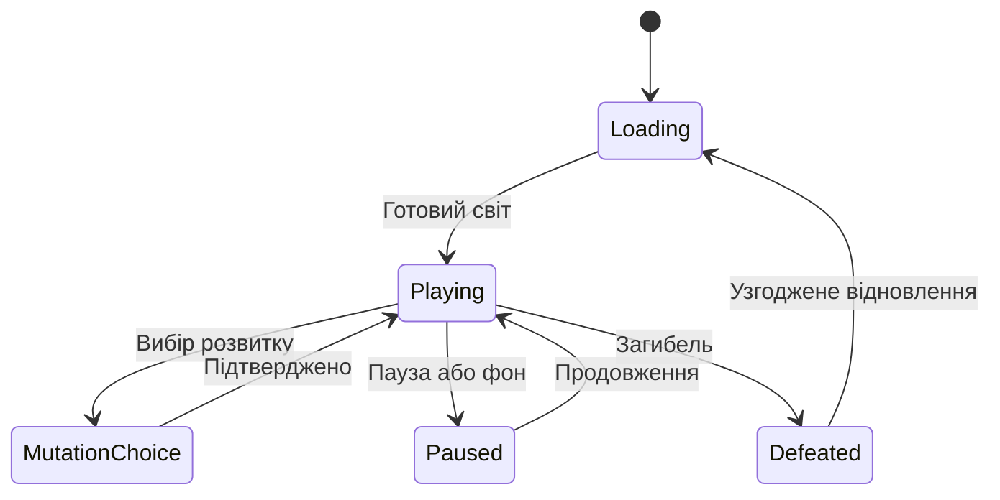

# 03. Основний цикл, камера та керування

Статус: редакція v0.5. Формат — повністю відкритий світ. Детальні правила керування, смерті й мутацій ще пропонуються. Пов'язані рішення: D-02–D-12.

## 1. Масштаби гри

**Кілька секунд:** помітити небезпеку, зайняти позицію, застосувати доступну функцію відростка та завершити контакт.

**Коротка активність:** дослідити ділянку, перемогти групу або виконати локальну ціль. Попередні 3–5 хвилин — можливий орієнтир такої події, а не обмеження сесії.

**Довша сесія:** самостійно пройти кілька зон, заробити валюту, розвинути героя, ризикнути біля сильної цілі або відступити. Вхід у сусідню зону не скидає здоров'я, біомасу, мутації чи перезарядки.

## 2. Безперервний цикл відкритого світу

1. Гравець починає новий світ або продовжує збережений прогрес за погодженими правилами.
2. Вибирає маршрут фізичним рухом; основні зони вільно доступні.
3. Бачить рівень небезпеки й вирішує, вступати в бій, обійти групу або відійти.
4. Поглинання дає біомасу; погоджені результати дають ігрову валюту.
5. Мутації й відкриті за валюту функції розширюють тактику.
6. Локальна ціль фіксує результат і нагороду без обов'язкового переходу в меню.
7. Гравець продовжує дослідження або завершує сесію з узгодженим збереженням.

Це замінює попередній цикл «вибрати сектор → пройти → отримати екран перемоги». Окрема тестова кімната може мати рестарт і результат для розробки, але таке завершення не є правилом світу.

Смерть героя припиняє його нові бойові дії. Відродження, можливі втрати й стан ворогів після повернення визначає D-10. Завершення однієї цілі не завершує весь світ і не видає загальну перемогу.

## 3. Стани сесії

Під час паузи й вибору мутації одиночна симуляція зупиняється. Локальна нагорода є окремою узгодженою операцією й не переводить світ у термінальний стан. Збереження економіки не залежить від завершення анімації підсумку.

## 4. Камера

Пропонується ортографічна камера зверху під кутом. Персонажі й середовище тривимірні; бойовий рух відбувається переважно по площині підлоги. Висота використовується для вигляду й ефектів, а не для складної платформної навігації.

Камера м'яко слідує за істотою та залишає більше видимого простору в напрямі руху. Стрибки масштабу під час звичайної атаки не потрібні. На босі можна трохи розширити огляд за заздалегідь підготовленою камерною зоною.

Стіни, що закривають гравця, опускаємо або ховаємо контрольовано. Важливі вороги не повинні атакувати з області, яку постійно перекриває HUD. Телеграф атаки з краю огляду має бути видимим до моменту ураження.

## 5. Базовий варіант керування для прототипу

| Дія | Пропоноване керування | Зворотний зв'язок |
| --- | --- | --- |
| Рух | Плаваючий джойстик у нижній лівій зоні | Поза й напрям тіла, легка реакція опорних кінцівок |
| Базова атака | Автоматично по доступній цілі в радіусі | Контур вибраної цілі, рух атакувального щупальця |
| Активний варіант здібності | Попередньо — кнопка справа; вибір функції та прицілювання ще вирішуються в D-03 | Іконка поточної функції, валідна ціль/точка, її перезарядка |
| Вибір мутації | Натиск картки на зупиненому екрані | Назва, короткий ефект і зміна силуету |
| Пауза | Кнопка зверху й системне згортання | Видимий стан паузи |

Це попередня схема з двома зонами взаємодії. D-03 тепер має визначити не лише ручне/автоматичне прицілювання, а й один активний варіант на забіг, перемикання або кілька кнопок. Вибір Венома й трьох функцій не означає автоматичне затвердження трьох одночасних кнопок. Варіанти — [у розділі 13](13_SYMBIOTE_ABILITIES.md).

На комп'ютері під час розробки рух можна перевіряти клавіатурою, а гак — кнопкою. Оцінка зручності все одно потребує сенсорного екрана.

## 6. Рух і напрям атаки

Напрям джойстика задає бажану швидкість у координатах видимої підлоги. Відпускання пальця зупиняє рух із коротким керованим уповільненням. Персонаж не продовжує їхати через накопичену фізичну інерцію.

Зіткнення з декором не повинні зачіпати декоративні щупальця. Рухове тіло має просту форму, а відростки візуально огинають поверхні або ховаються. Після мутації в MVP зберігаємо стабільну форму основної колізії, щоб істота проходила знайомими коридорами.

Базова атака дозволена під час руху. Напрям корпусу може трохи відставати від обраної цілі, але механіка не вимагає повертатися до неї всім тілом. Візуальна поза повинна показувати, які кінцівки відповідають за рух, а які — за контакт.

## 7. Вибір цілі

Для базової атаки система відкидає мертві, недоступні та закриті суцільною перешкодою цілі. Серед доступних надає перевагу вже вибраній цілі, потім близькій загрозі. Коротка стабілізація вибору запобігає постійному смиканню між двома сусідніми ворогами.

Для AB-PULL ціль позначається до натиску. Перевага — противнику в напрямі наміру гравця, далі враховується дистанція. AB-MOVE натомість показує допустиму опору та кінцеву позицію героя; AB-DAMAGE — ціль або область сильного удару. Остаточне прицілювання залежить від D-03.

Якщо для поточної функції немає валідної цілі/точки, кнопка показує недоступність і не витрачає перезарядку. Валідований запуск із подальшим промахом витрачає її за правилом конкретного варіанта. Недоступність до старту й промах після старту мають різну реакцію інтерфейсу.

## 8. Три ролі симбіотичного відростка

За рішенням власника закладено варіативність: **притягування, переміщення й підвищена шкода**. Це різні результати застосування одного симбіотичного інструмента, а не вимога одночасно виконувати їх кожним натиском.

AB-PULL переміщує доступного противника до героя й допомагає розбирати групу. AB-MOVE переміщує самого героя до допустимої точки з перевіркою траєкторії. AB-DAMAGE пропонується як сильний удар/ультимейт із довшою перезарядкою. Гак сам собою не поглинає здорового ворога.

Пересування гаком тепер входить до обраних функцій і враховується в дизайні арен. Хитання, вільне лазіння по стінах і багатоповерховість ще не обрані. Для важких цілей, опор, перешкод і переривання див. [розділ 13](13_SYMBIOTE_ABILITIES.md).

Один активний варіант, перемикання чи одночасні здібності — відкрите D-03. Спільний або окремі cooldown також ще не вирішені. Перший тест може порівняти три окремі запуски кімнати з однією активною функцією в кожному.

Відкриття за ігрову валюту вже обрано в D-11. Пропонується проводити його в меню й зберігати між забігами, а активні бойові таймери лишати станом поточного забігу. Ціна відкриття не сплачується за кожен удар. Кількість одночасних кнопок визначається окремо; див. [економіку](05_EVOLUTION_AND_ECONOMY.md).

## 9. Мутація під час небезпеки

Коли досягнуто кілька порогів біомаси одним завершенням подій, вибори ставляться в чергу. Відкриваємо по одному екрану. Після кожного вибору перераховуємо доступні картки й актуальні характеристики.

Поки гравець читає картки, небезпека не рухається. Після закриття екрана керування не повинно помилково приймати натиск картки за натиск гака або рух джойстика. Усі старі дотики скидаємо й чекаємо нового введення.

Якщо разом із порогом зафіксовано смерть героя, переходимо у стан загибелі; новий вибір мутації в цей момент не відкривається. Подальше відновлення визначає D-10.

## 10. Перерва, вихід і продовження

Згортання ставить гру на паузу; після повернення потрібне явне продовження й нове введення. Перетин зони не відкриває меню результату та не створює новий стан героя.

Пропонується зберігати прогрес світу, параметри героя та безпечну точку повернення. Після завершення процесу Android відновлюється останній узгоджений стан; точність відновлення живого бою ще проектується. Валюта й відкриття здібностей записуються узгодженими операціями.

Скидання карти доступне лише як явно визначена дія нового світу або тестового інструмента. Звичайне продовження не відновлює вже отримані одноразові нагороди.

## 11. Що перевіряємо руками

Керування, контакт і вибір цілі; вільний маршрут до сильнішої зони; повернення без скидання здоров'я й КД; локальна нагорода без переходу в меню; відсутність повторного дропу при поверненні; збереження й продовження. Для довгого життя мутацій потрібен перегляд старих порогів і пулу карток у D-07.

Повний контракт формату — [розділ 14](14_OPEN_WORLD.md).
